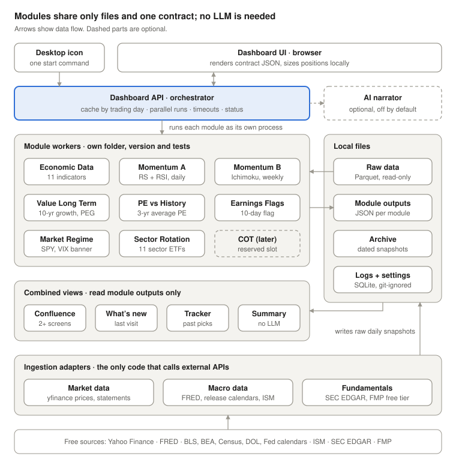

# 07 · Architecture — Swing Trading Dashboard

Oct 31, 2026 · @Arindam Patranabis · Status: Proposed

## Context

The [swing-trading-dashboard](https://github.com/ArindamPatranabis/swing-trading-dashboard) repo is at Phase 0: the product docs are written, but `src/`, `tests/`, `config/` and `docs/adr/` hold only placeholders. This architecture is therefore greenfield, and it answers PRD open questions Q8 (module runtime), Q11 (hosted link) and Q17 (rows returned).

The product is a single-user research dashboard for the S&P 500 + Nasdaq 100 (about 550 tickers), opened on demand from a Windows desktop icon. It has four core modules (Economic Data, Momentum, Value – Long Term, Value – PE vs History) plus supporting views: regime banner, sector rotation, earnings flags, confluence list, archive, past-picks tracker and summary.

**What the repo already fixes, which this architecture must honour**

| Source in repo | Constraint |
| --- | --- |
| PRD PLAT-FR-01, NFR-07 | One versioned JSON output contract for every module, checked by a contract test |
| PRD PLAT-FR-03 | Each module in its own folder with own data, tests and version; no imports between modules except the shared contract package |
| PRD PLAT-FR-02, NFR-03 | One failed or timed-out module never blocks another (100% of runs) |
| PRD PLAT-FR-04, PLAT-FR-05 | Cache per trading day; refresh only stale modules, in parallel, with a minimum interval |
| PRD NFR-01, NFR-02 | Under 60 s from cache; full refresh under 5 min |
| PRD PARAM-FR-03 | A parameter change re-runs on cached data in under 10 s with no API calls |
| PRD DASH-FR-04 | Thin dashboard: no screening logic, only position sizing and universe filtering |
| PRD NFR-09 | Running cost under $5/month |
| PRD NFR-10, NFR-15 | Keys and the owner's capital and risk inputs never committed or published |

**Gaps found in the repo**

- `requirements.txt` pins the `anthropic` SDK in the core install, which conflicts with the no-LLM constraint; the file is also saved as UTF-16, which some tooling (Dependabot, uv) handles poorly.
- Specs 2 and 3 were transcribed from scripts that read tickers from an Excel file dropped on a `.bat`; that input becomes a universe file in `config/`.
- Spec 3 (RS cross + RSI) differs from PRD Screen A, and Spec 4 runs on weekly bars; the two Momentum screens are split into separate modules so either can change alone (ADR-012).
- Spec 6 (management and superinvestors) has no PRD requirement yet; it gets a reserved module slot, like COT.

## Architecture drivers

Four owner constraints drive every decision below, and each one maps to a check that CI can run.

| # | Constraint | What it means in this design | How it is verified |
| --- | --- | --- | --- |
| 1 | Every module separate, tested and changed alone | Each module, data adapter and view is its own package with its own version, tests and fixtures. It runs from the command line against a fixture folder with no other module installed. | One CI job per package, triggered by path filters; an import-linter rule fails the build on any cross-package import |
| 2 | Low cost | $0 baseline: runs on the owner's PC, free data sources, free CI and hosting; nothing always-on in the cloud | Cost log per run (PLAT-FR-08); monthly total under $5 |
| 3 | Runs without Claude or any LLM | The core install contains no LLM SDK and makes no LLM calls. Summaries and "why flagged" notes come from templates over rule results. An AI narrator is an optional plugin, off by default. | A CI job installs the core only, blocks LLM endpoints, and runs the full pipeline end to end |
| 4 | Microservices where required | Process isolation for every module by default; a network service only where something must stay running, be hosted separately, or isolate a secret | Promotion rule in ADR-002, reviewed for each new unit |

The PRD adds three quality goals that shape the runtime: failure isolation in 100% of runs, a cached open under 60 s, and a full refresh under 5 min.

## Target architecture

Every module is a separate worker process that reads immutable raw data and writes one contract file; only two parts run as network services, and the core has no LLM anywhere.



Adapters fetch free sources into raw snapshots, the orchestrator runs each module as its own process against them, and the UI renders whatever contract files exist, marking any missing section "unavailable". The archive view (not drawn) copies each refresh's outputs into a dated snapshot.

## Service catalogue

The system has 2 network services, 3 data adapters, 9 module workers, 5 combined views and 1 shared library. Only adapters call external APIs; only the contract library is shared.

| Unit | Kind | Owns (writes) | Reads | Requirements |
| --- | --- | --- | --- | --- |
| `dashboard_api` | HTTP service (FastAPI, 127.0.0.1) | Run orchestration, cache index, rendered pages | All module and view outputs | DASH-FR-01 to 07, PLAT-FR-02/04/05 |
| `web` (inside `dashboard_api`) | Server-rendered HTML + small JS | Nothing; sizing inputs stay in the browser and local settings | Contract JSON | DASH, MOM-FR-07, PARAM-FR-01 |
| `launcher` | Desktop shortcut + PowerShell script | Nothing | Nothing | DASH-FR-01 |
| `ai_narrator` (optional) | HTTP service, separate process | AI text, its own cost log | Contract JSON only | AI-FR-01 to 03 |
| `adapter_market` | Worker | `raw/prices`, `raw/statements`, `raw/earnings`, `raw/meta` | yfinance, universe file | NFR-05, PLAT-FR-07 |
| `adapter_macro` | Worker | `raw/macro`, `raw/calendars` | FRED, official calendars, ISM manual entry | ECON-FR-07, ECON-FR-08 |
| `adapter_fundamentals` | Worker | `raw/fundamentals` | SEC EDGAR, FMP free tier | VLT dependency |
| `econ` | Module worker | `out/econ` | `raw/macro`, `raw/calendars` | ECON-FR-01 to 08 |
| `momentum_rs_rsi` | Module worker (daily) | `out/momentum_rs_rsi` | `raw/prices`, `raw/meta` | MOM-FR-01, 02, 04 to 06 · Spec 3 |
| `momentum_rs_ichimoku` | Module worker (weekly) | `out/momentum_rs_ichimoku` | `raw/prices`, `raw/meta` | MOM-FR-03 to 06 · Spec 4 |
| `value_long_term` | Module worker | `out/value_long_term` | `raw/fundamentals`, `raw/prices`, `raw/meta` | VLT-FR-01 to 05 · Spec 1 |
| `value_pe_history` | Module worker | `out/value_pe_history` | `raw/statements`, `raw/prices` | PER-FR-01 to 05 · Spec 2 |
| `market_regime` | Module worker | `out/market_regime` | `raw/prices` (SPY, VIX, DXY, MOVE) | REG-FR-01, 02 · Spec 5 |
| `sector_rotation` | Module worker | `out/sector_rotation` | `raw/prices` (11 sector ETFs, SPY) | SECT-FR-01, 02 · Spec 5 |
| `earnings_flags` | Module worker | `out/earnings_flags` | `raw/earnings` | EARN-FR-01 |
| `cot` | Module worker (placeholder) | `out/cot` | Nothing yet | COT-FR-01 |
| `confluence` | View | `out/confluence` | Module outputs | CONF-FR-01 |
| `whats_new` | View | `out/whats_new` | Current and previous snapshot | DASH-FR-05 |
| `tracker` | View | `out/tracker` | Archive, `raw/prices` | TRACK-FR-01 |
| `summary` | View (template, no LLM) | `out/summary` | Module outputs | AI-FR-02 equivalent |
| `archive` | View | `archive/<date>/` HTML + JSON, SQLite index | All outputs | ARCH-FR-01 to 04 |
| `stdash_contract` | Library | Output and raw-data schemas, run harness | — | PLAT-FR-01, NFR-07 |

**Anatomy of one module** (the same for every module, adapter and view):

```
modules/momentum_rs_rsi/
  pyproject.toml          # version 0.1.0; depends only on stdash_contract + pandas
  module.toml             # needs = ["prices.daily", "meta"], cadence = "daily", timeout_s = 120, spec = "spec-3@0.1"
  src/momentum_rs_rsi/
    validate.py           # schema, ranges, 95% coverage check
    rules.py              # pure functions: DataFrame in, rows out
    main.py               # run(raw_dir, params, as_of) -> ModuleOutput
  tests/
    fixtures/             # small Parquet files, committed (synthetic, not vendor data)
    test_rules.py         # PRD acceptance values, e.g. RSI within 0.1, quantity 54
    test_contract.py      # output validates against contract v1 schema
```

Run alone: `python -m momentum_rs_rsi run --raw tests/fixtures --params defaults.json --out /tmp/out.json`. No network, no other module, no dashboard.

## ADR log

Twelve decisions, all **Proposed** until the owner accepts them. Each is its own file in [`docs/adr/`](adr/).

| ADR | Decision | Answers | Status |
| --- | --- | --- | --- |
| [ADR-001](adr/ADR-001-modules-run-as-isolated-worker-processes.md) | Modules run as isolated worker processes | PRD Q8 | Proposed |
| [ADR-002](adr/ADR-002-where-microservices-are-used.md) | Where microservices are used | Constraint 4 | Proposed |
| [ADR-003](adr/ADR-003-one-versioned-output-contract.md) | One versioned output contract | PLAT-FR-01, Q17 | Proposed |
| [ADR-004](adr/ADR-004-shared-ingestion-with-immutable-raw-snapshots.md) | Shared ingestion with immutable raw snapshots | PLAT-FR-05, rate-limit risk | Proposed |
| [ADR-005](adr/ADR-005-files-parquet-duckdb-and-sqlite-no-database-server.md) | Files, Parquet, DuckDB and SQLite; no database server | Constraint 2 | Proposed |
| [ADR-006](adr/ADR-006-cache-keyed-by-trading-day-parameters-and-versions.md) | Cache keyed by trading day, parameters and versions | PLAT-FR-04, PARAM-FR-03 | Proposed |
| [ADR-007](adr/ADR-007-no-llm-in-the-core-ai-narrator-is-an-opt-in-plugin.md) | No LLM in the core; AI narrator is an opt-in plugin | Constraint 3 | Proposed |
| [ADR-008](adr/ADR-008-server-rendered-html-with-small-js-no-spa-build.md) | Server-rendered HTML with small JS; no SPA build | DASH-FR-04, NFR-13 | Proposed |
| [ADR-009](adr/ADR-009-local-first-runtime-optional-static-hosted-sample.md) | Local-first runtime; optional static hosted sample | Q11, NFR-09 | Proposed |
| [ADR-010](adr/ADR-010-monorepo-of-independently-versioned-packages.md) | Monorepo of independently versioned packages | Constraint 1, PLAT-FR-03 | Proposed |
| [ADR-011](adr/ADR-011-failure-isolation-and-run-logging-in-the-harness.md) | Failure isolation and run logging in the harness | PLAT-FR-02, PLAT-FR-08 | Proposed |
| [ADR-012](adr/ADR-012-momentums-two-screens-become-two-modules.md) | Momentum's two screens become two modules | Spec 3 vs Screen A | Proposed |

## Deployment and cost

Baseline running cost is $0 per month; with the optional AI narrator under its hard cap it is at most $3, inside the PRD's $5 target (M8, NFR-09).

| Item | Choice | Cost per month |
| --- | --- | --- |
| Compute | Owner's Windows PC; 2 processes while open (`dashboard_api`, plus `ai_narrator` only if enabled) and short-lived workers during a refresh | $0 |
| Market data | yfinance (unofficial Yahoo Finance access; personal use; isolated in `adapter_market` so a replacement touches one package) | $0 |
| Macro data | FRED API (free key) and official BLS, BEA, Census, DOL and Fed calendars; ISM PMIs by manual entry if needed | $0 |
| Fundamentals | SEC EDGAR company facts (free, needs a contact User-Agent) for 10-year history; FMP free tier as fallback | $0 |
| Storage | Local disk: Parquet, JSON, SQLite | $0 |
| CI | GitHub Actions on a public repo, path-filtered jobs plus nightly and weekly runs | $0 |
| Hosted sample | GitHub Pages, static, fixture data only | $0 |
| AI narrator | Optional, off by default, any provider, hard monthly cap | $0–3 |
| **Total** | | **$0 baseline, $3 maximum** |

**What runs when the icon is clicked:** the launcher starts `dashboard_api` (or reuses it), which serves the last cached outputs at once. "Refresh" runs stale adapters, then affected modules in parallel subprocesses, then views, then writes the archive snapshot. Secrets (FRED key, optional LLM key) live in `.env`, which is git-ignored, and in GitHub Secrets for CI (NFR-10).

## Build roadmap

The repo has no code yet, so this is the build order mapped onto the PRD's release plan; each step ships whole packages, never half a module.

1. **Weeks 1–2, foundation.** Accept or amend the ADRs. Re-save `requirements.txt` as UTF-8 and split it into core and an `[ai]` extra. Scaffold the uv workspace, `stdash_contract` v1.0.0 with the run harness, the copier module template, the import-linter rules and path-filtered CI.
2. **v0.1 MVP, week 6.** `adapter_market`, `adapter_macro`; modules `econ`, `momentum_rs_rsi`, `cot` placeholder; `dashboard_api` with the section shell, launcher and archive; the failure-isolation test in CI.
3. **v0.2, week 9.** `adapter_fundamentals`; modules `momentum_rs_ichimoku`, `value_pe_history`, `value_long_term`, `market_regime`, `sector_rotation`, `earnings_flags`; the `confluence` view; parameter panels and the position-sizing bar.
4. **v0.3, week 11.** Views `whats_new`, `tracker` and the template `summary`; print-to-PDF export; saved presets; the optional `ai_narrator` plugin.
5. **v1.0, week 12.** GitHub Pages sample from fixtures, weekly live API health job, 80% coverage per package, fresh-machine setup test.

**Decisions the owner needs to make before week 2**

- [ ] Amend the vision's "Own data" rule to allow shared read-only raw snapshots (ADR-004)
- [ ] Confirm the Momentum split into two modules (ADR-012)
- [ ] Settle Spec 3 Q1: does the RS cross + RSI rule replace PRD Screen A or run beside it?
- [ ] Confirm the template summary is acceptable when the AI narrator is off (ADR-007)

_Disclaimer: personal research project, not investment advice._
